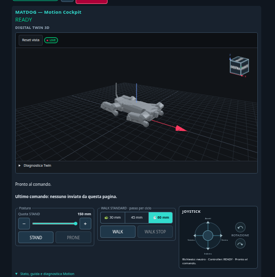
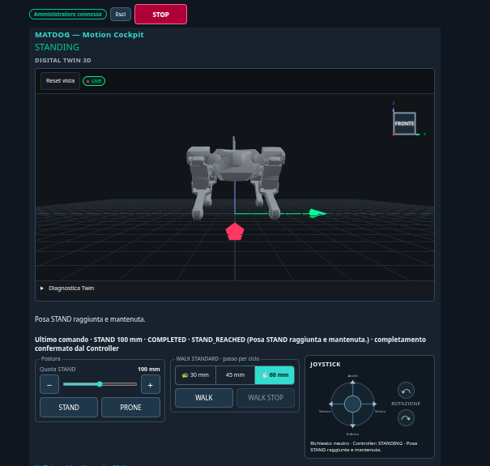

# MATDOG 1.0.1-dev.17 — validazione hardware e prima Stable GitHub (07/11/2026)

> **Classificazione: VERIFIED HARDWARE — CURRENT ROBOT, QUALIFIED FUNCTIONAL SCOPE.**
> L'APP dev.17 realmente installata sul MATDOG attuale è promossa, **senza ricompilazione**, a prima release stabile GitHub (`v1.0.1`) per il perimetro funzionale provato qui sotto, su decisione esplicita dell'operatore che accetta i limiti noti (§5). Non è una certificazione di sicurezza industriale, né una garanzia real-time a 20 ms, né una validazione su hardware diverso da questo robot.

Collegamenti: [candidata dev.17 (cause, correzioni, regressioni offline)](../Dev17_Candidate_2026-11-07/REPORT.md) · [procedura flash/collaudo](../Dev17_Candidate_2026-11-07/FLASH_AND_TEST.md) · [manifest evidenze](EVIDENCE_MANIFEST.md) · [manifest firmware/release](RELEASE_MANIFEST.md) · [metriche tracce](TRACE_METRICS.csv) · [comandi conservati](COMMANDS_RETAINED.csv) · [osservazioni operatore](OPERATOR_OBSERVATIONS.md) · storico [dev.16 HW](../Dev16_HW_2026-11-07/REPORT.md), [dev.15 HW](../Dev15_HW_2026-11-06/REPORT.md).

## 1. Identità del firmware installato

| Elemento | Valore |
|---|---|
| Stringa interna | `1.0.1-dev.17` (resta tale: il tag `v1.0.1` promuove questi byte, non li ricompila) |
| Commit sorgente dell'APP | `17db0efe23242ae8932b5549546a9758d9aa4645` (non è il commit di merge della PR) |
| Build ID | `17db0efe2324` |
| APP | 1.707.808 byte, SHA256 `14e055a0bfa2adcab8f87df29ece0a0cf01a6e9e13b99aee1c94bda59ba84a83` |
| Profilo / manifest | `ROBOT_POWERED`, `SOURCE_STATE=CLEAN`, `GIT_DIRTY=0`, `OTA_INGEST_ENABLED=0`, `PRIVATE_TLS_CONFIGURATION_SHA256=ABSENT` |
| Layout / slot | `MATDOG_16M_2x5M_NVS_V1`, tabella `8f756ecb…`, `app0` @ `0x010000` (scrittura 0x010000–0x1b0f20) |
| Rollback | dev.16 `e0ddbb1791d0`, APP `73952eec1ddb29976941b7afd16149b15f790a2e8c46cb2067d1f72a8424138d` (1.694.048 B) |

## 2. Flash APP-only, boot e audit IDLE (07/11/2026, originali ASUS)

Evidenze originali: `~/MATDOG/verification-artifacts/MATDOG_DEV17_FLASH_PREP_20261107/` (`EVIDENCE.sha256` 26/26 OK alla promozione); copia byte-identica dei registri privi di percorsi locali in [`raw/MATDOG_DEV17_FLASH_BOOT_IDLE_2026-11-07.zip`](raw/MATDOG_DEV17_FLASH_BOOT_IDLE_2026-11-07.zip). Dettaglio in [EVIDENCE_MANIFEST.md](EVIDENCE_MANIFEST.md).

| Fase (UTC) | Risultato letto dai registri |
|---|---|
| Preflight 18:30:34 (solo HTTP) | dev.16 `e0ddbb1791d0` READY/RUN, census 13/13, NVS gen-1 `VALID_ACKNOWLEDGED` (ack gen 1, record intatto), `safe_off_mask=8191`, coppia 0 sui 12 giunti, nessun fault, BMS 11,3 V con età 26–264 ms; candidata, APP dev.16 e backup completo: SHA 3/3 OK; manifest CLEAN |
| Supporto fisico | confermato esplicitamente dall'operatore prima della ROM (non dedotto dalla telemetria) |
| ROM 18:32:08 | un solo `usb-reset`, MAC `14:c1:9f:22:75:94`; layout/otadata in sola lettura: tabella `8f756ecb…`, slot attivo `app0`, rollback bootloader abilitato |
| Flash 18:32:20–18:33:09 | **una** `write-flash`: `Wrote 1707808 bytes at 0x00010000`, `Hash of data verified`; `verify-flash` indipendente: `Verification successful (digest matched)`; `APPLICATION_ONLY_FLASH = PASS`. Nessuna scrittura di bootloader, tabella, otadata, NVS, EEPROM, eFuse o `app1` |
| Boot 18:33:15 | watchdog-reset; a 18:33:39 uptime 20,9 s (un solo avvio): `firmware_version=1.0.1-dev.17`, `build_id=17db0efe2324`, READY/RUN, census 13/13, IMU/BMS/SERVO PASS, NVS gen-1 `VALID_ACKNOWLEDGED`, nessun restore o calibrazione, `safe_off_mask=8191`, coppia OFF |
| IDLE 18:34:38, 91 s, solo GET | 160/160 HTTP 200 (79 `/status`, 79 `/api/motion/status`, 2 dashboard `/`), 0 timeout, 0 × 503, 0 incomplete; Motion 50,00 Hz, 0 release perse, 0 overrun; `loop_stack_min_free` 6.864 B; `status_service_max_us` 1.917 µs; uptime monotono; nessun fault |

Il monitor CDC non è stato aperto dopo il boot. L'audit IDLE ha usato solo letture.

## 3. Sessione operatore (tracce `(33)`–`(36)`)

Archivio originale fornito dall'operatore, pubblicato byte-identico: [`raw/MATDOG_DEV17_HARDWARE_VALIDATION_2026-11-07.zip`](raw/MATDOG_DEV17_HARDWARE_VALIDATION_2026-11-07.zip) (SHA256 `b1edd6cf…65d3`, `SHA256SUMS.txt` interno 11/11 OK, JSON non modificati). Metriche ricalcolate dai JSON originali e coincidenti con [TRACE_METRICS.csv](TRACE_METRICS.csv).

**Provenienza firmware delle tracce.** Le tracce non registrano la stringa di versione, ma ogni campione contiene `transport.status_service_max_us` e ogni comando `input_ms`: campi presenti solo nella dev.17 consolidata (`17db0ef`). L'orologio del Controller è continuo da `(33)` (62,6 s) a `(36)` (1.155 s): un solo avvio per tutta la sessione. Quell'avvio è successivo all'audit IDLE (gestione USB/alimentazione dell'operatore); nessuna scrittura flash è avvenuta tra i due.

| Traccia | Contenuto | Esito |
|---|---|---|
| `(33)` | IDLE, Twin, ViewCube/triade, Reset vista, STOP visibile; 54,3 s | 0 perse, 0 overrun, SAFE_OFF 8191, nessun fault |
| `(34)` | STAND100 in 11,831 s (quota stimata ~98,6 mm), HOLD | `COMPLETED/STAND_REACHED`; +2 overrun nella finestra, nessuno nuovo in HOLD; 4 letture > 1 s (max 1,68 s), 0 `poll_errors` |
| `(35)` | refresh con coppia ON in HOLD (Twin ricomparso, primo lento); STAND125 2,875 s → STAND100 2,402 s; WALK45 → WALK STOP 8,948 s; WALK60 → WALK STOP 8,934 s | tutti `COMPLETED/STAND_REACHED`; finestra 83,7 s: +1 persa, +314 overrun, lavoro max 33,412 ms |
| `(36)` | STOP durante WALK e WALK diretto dopo STOP (osservati dall'operatore, fuori dagli ultimi 48 comandi conservati); joystick proporzionale prolungato (seq 72–117), rilascio seq 118 `COMPLETED/STAND_REACHED` 8,865 s; PRONE seq 119 `COMPLETED/PRONE_REST` 12,633 s | finale `READY/IDLE/PRONE_REST`, `safe_off_verified=true`, `safe_off_mask=8191`, `torque_active=false`, `fault=false`; finestra 83,5 s: **+64 perse, +491 overrun**, lavoro max **47,215 ms**, `loop_stack_min_free` minimo **2.060 B** |

Regole di lettura: le finestre `(34)/(35)/(36)` si sovrappongono parzialmente e **non vanno sommate**; l'unico `TIMEOUT_3500MS` conservato in `(35)` e ripetuto in `(36)` è **un solo evento**. Contatori cumulativi del Controller a fine sessione (non una somma di finestre): 76 release perse e 1.163 overrun su ~1.155 s di uptime (~57.700 release). Lo STOP→WALK diretto ha conferma fisica dell'operatore ma **nessun ACK conservato**: la traccia `(36)` tiene solo le sequenze 72–119.

Dopo l'esportazione l'operatore ha spento il robot con KEY OFF del BMS e lo ha riposto sulla fixture.

Screenshot della dashboard durante la sessione (copie byte-identiche dei PNG nello ZIP, vedi [manifest](EVIDENCE_MANIFEST.md#d-screenshot-pubblicati-in-chiaro)):

| READY, Twin e ViewCube (file delle 18:47) | STAND100 raggiunto, Twin in vista FRONTE (file delle 18:52) |
|---|---|
|  |  |

## 4. Perimetro VERIFIED HARDWARE (questo robot, dev.17)

- IDLE, dashboard Motion Cockpit operativa, STOP sempre visibile.
- STAND100; STAND125 e ritorno a STAND100; HOLD.
- WALK STANDARD 45 e 60 mm/ciclo; WALK STOP.
- STOP durante movimento e **ripresa WALK con comando diretto dopo STOP**, senza STAND150 obbligatorio (osservazione operatore; ACK fuori buffer).
- Joystick proporzionale avanti + laterale prolungato e rilascio.
- PRONE finale con SAFE_OFF 13/13 e coppia OFF.
- Digital Twin visibile e recuperabile dopo refresh in HOLD con coppia ON, anche con refresh ripetuti; ViewCube, triade, Reset vista e controlli.
- NVS gen-1 `VALID_ACKNOWLEDGED` dopo flash e boot, senza ricalibrazione.
- Nessun fault nei campioni conservati; nessuna instabilità fisica osservata dall'operatore.
- Vibrazione della zampa anteriore sinistra **non più osservata** durante WALK basso a 60 mm/ciclo (osservazione ravvicinata dell'operatore); il claim vale solo per questa condizione.
- Twin che non ruota più visibilmente durante STAND (osservazione).

## 5. Limiti noti accettati dall'operatore per questa Stable

- **Timing:** il budget di 20 ms non è rispettato sotto carico di gait/joystick (finestra `(36)`: +64 perse, +491 overrun, lavoro max 47,215 ms). Il robot ha completato i comandi senza fault né perdita di controllo osservata, ma **non** è dimostrato un controllo real-time rigido a 20 ms né zero overrun/perse.
- **Margine di stack del loop:** minimo osservato 2.060 B nella finestra `(36)` (dev.16: ≥ 4.208 B; soglia di arresto della procedura 1,5 KB). Da monitorare e ridurre nel prossimo ciclo.
- **Velocità:** gait lento; obiettivo fino a 5× non affrontato.
- **Sway laterale del joystick** maggiore della camminata a pulsante; non corretto.
- **HTTP:** rari stalli/risposte lunghe con coppia ON (`(34)`: max 1,68 s); causa delle perdite TCP non dimostrata (serve cattura pacchetti).
- **STOP durante il caricamento a cache fredda del Twin su telefono reale:** non misurato end-to-end (solo misura Chrome offline fino a ~0,5 s).
- Non ricollaudati in dev.17: singole quote 50–150 oltre 100/125, rotazioni IMU pitch/roll, sottosistema LED (verde stabile osservato, non qualificazione), RESTORE manuale/multigenerazione, WALK FAST, funzioni avanzate.
- Twin: zampe posteriori apparentemente sospese sul pavimento grafico in PRONE (visualizzazione, non misura di contatto); overlay dei comandi dentro il Twin richiesto come UX futura.
