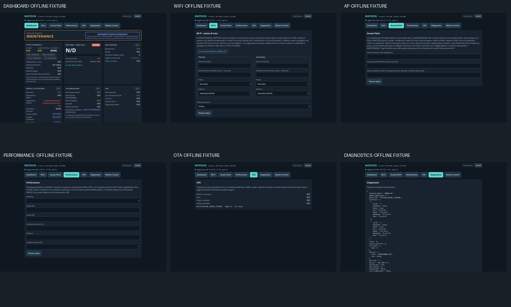
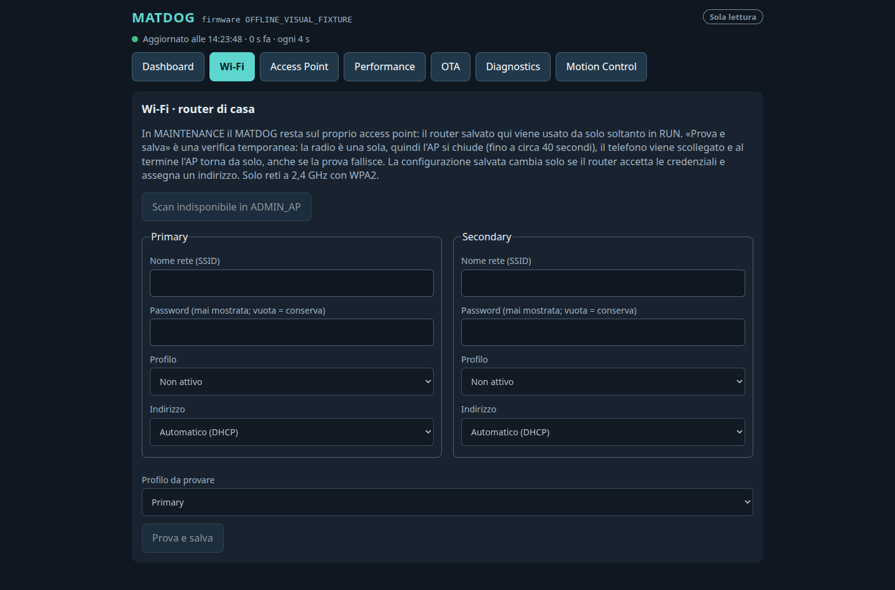
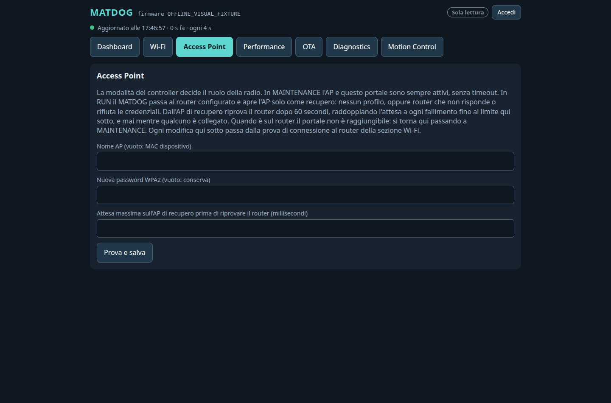
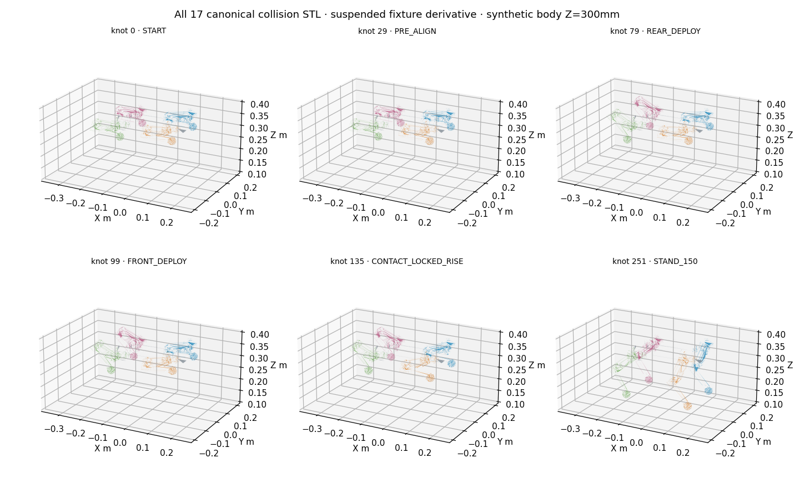
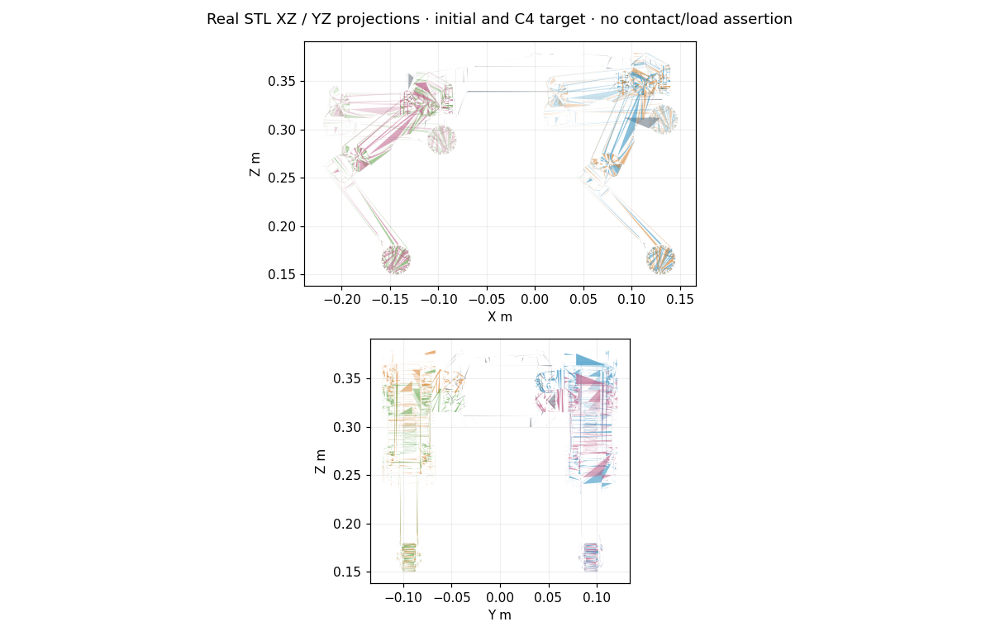
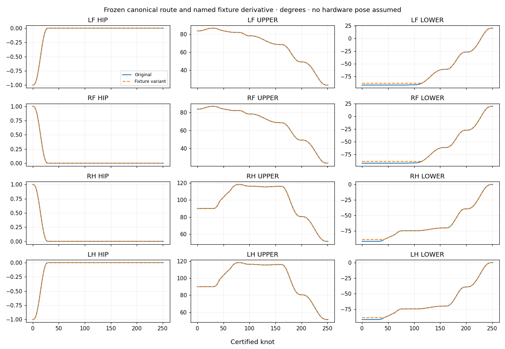
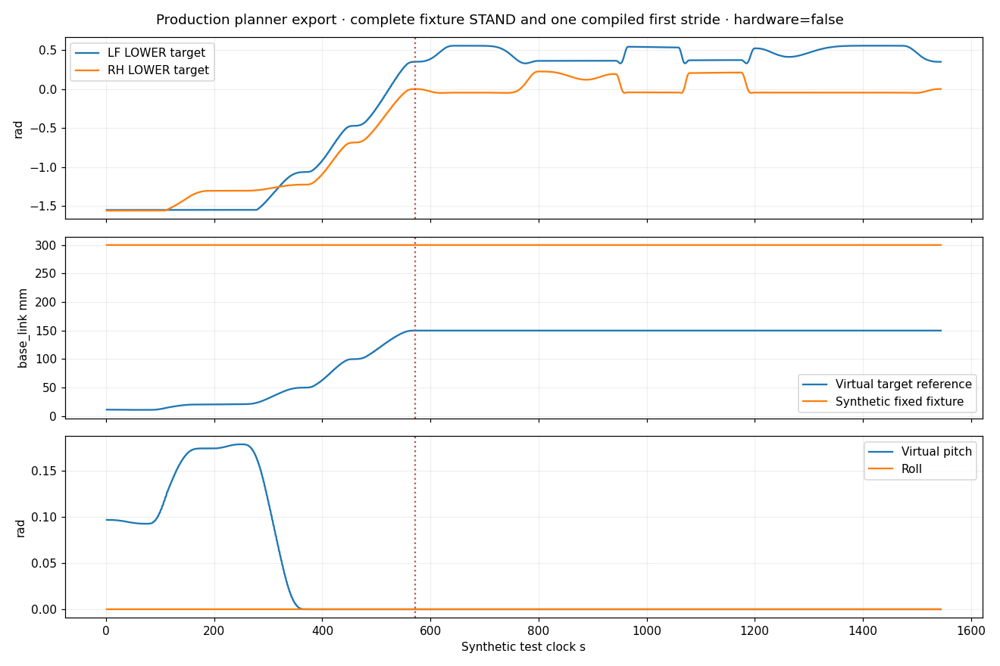
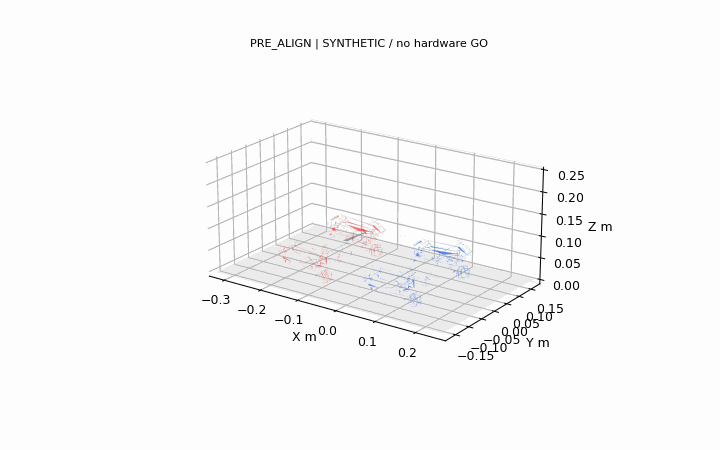

# Galleria — evidenza software/offline MATDOG

Nessuna immagine qui mostra una validazione hardware eseguita oggi. Screenshot: Chromium reale contro fixture localhost, sorgente Dashboard effettivo. Cinematica: URDF e 17 STL canoniche, route congelata e valori emessi dai test runtime; feedback dichiaratamente sintetico/ideale e quantizzato nel test di pipeline. La quota 300 mm nelle figure è uno scenario di fixture del test, **non** una misura o un preset operativo. Render non equivale a collision certificate né contatto geometrico a carico.

## Dashboard e gate

[Desktop con le 48 azioni](dashboard_motion_desktop.png) · [mobile](dashboard_motion_mobile.png) · [receipt browser](browser_receipt.json).

| LAN MAINTENANCE read-only | ADMIN_AP, fixture visiva |
|---|---|
|  |  |

[Gate Motion dalla LAN: 48 controlli disabilitati](lan_motion_gates.png). STOP operativo rimane sul percorso USB locale sicuro/RUN autenticato, non è un POST permesso dalla LAN read-only. I veri handler C++ sono verificati separatamente dai test di produzione; il server Python delle immagini è solo una fixture e non può comandare hardware.

## STL, route e runtime

[Manifest renderer e mesh](render_manifest.json) · [certificato variante](../fixture_final_margin_route_6mrad.json) · [tube canonico](../stand_tracking_tube_6mrad.json) · [prima falcata swept](../first_stride_30mm_qualified_clock_swept_6mrad.json) · [encoding runtime in flash](../compiled_first_stride_receipt.json).

## Digital Twin e animazioni conservate

[Video browser STAND→WALK](fixture_stand_walk_browser.mp4) · [timeline di 42 frame e tempi del test](video_timeline.json). Acquisizione reale Chromium della trace offline, riproduzione compressa a 6 fps; nessuna telemetria o arresto fisico dimostrato.

[Prone su fixture](twin_PRONE.png) · [rear deploy](twin_REAR_DEPLOY.png) · [front deploy](twin_FRONT_DEPLOY.png) · [C4](twin_STAND_C4.png) · [WALK](twin_WALK.png). Il browser ha verificato 17 mesh, 12 giunti, body XYZ e rimozione del target quando stale. I canali actual/target restano distinti anche dove il modello di feedback ideale coincide.

[Proiezioni originali](../../Motion_Night_Run_2026-10-12/projections_xz_yz.png) · [giunti/quota/pitch originali](../../Motion_Night_Run_2026-10-12/paired_angles_height_attitude.png) · [piedi/contatti geometrici](../../Motion_Night_Run_2026-10-12/feet_contacts.png). Questi artifact storici sono collegati, senza duplicarli o riattribuirli al nuovo commit.

Sorgente catturato identificato dai digest di PortalPage/MotionDashboard nel receipt browser; trace e renderer hanno propri SHA. Il receipt finale di build identifica separatamente il commit clean compilato. `SHA256SUMS` permette la verifica di tutti i media pubblicati. Le prove hardware pregresse restano quelle dei report dell'11 ottobre, senza estensione automatica a questa release.

Versione sorgente compilata: [`b147f3884b227ec819e98a6f00c214a0aac2278e`](https://github.com/MattRobotics/robot-dog/commit/b147f3884b227ec819e98a6f00c214a0aac2278e). App SHA256 `5577bd3c8da5f6c44d8fb9ca9b3d049399e73ccf37d218e716b773e3a87b5914`; [build receipt](../BUILD_RECEIPT.json). I digest dei file UI, renderer, trace e media identificano separatamente la cattura offline.
