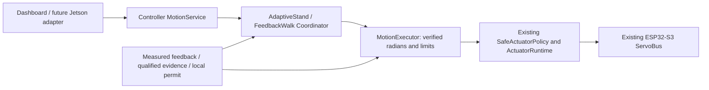

# MATDOG Motion software candidate — 12 October 2026

## Source and scope

Use only the managed Motion worktree based on
`fdd04345c39b50137cc7cdc50fb08cd592b8c2af`. The installed closeout image is
`b08322dedc5564c080f691dc98047511ef2b953f`; it is not this source revision.
The candidate remains uncommitted for review. No flash, OTA, serial/device
connection, torque, physical motion, NVS/EEPROM write or erase occurred.
The hardware-validated 24/24 calibration and generation 1 record are retained.

## Transport-independent command contract

`MotionContract` version 1 carries an ID, per-owner sequence, Controller uptime
timestamp, TTL, owner, typed intent and semantic parameters. Dashboard and future
Jetson use the same `MotionService` admission and planner APIs. A transport's
claimed owner is not actuator authority; the HTTP adapter only admits dashboard
requests from its existing AP/session/origin/CSRF fence. RUN recovery/no-profile AP can admit Motion HTTP in RUN. Normal RUN_STA revokes
AdminAccess, so a separate authenticated operational transport remains a software
blocker. Existing maintenance configuration remains inhibited in RUN. No Jetson
transport, ROS 2 or terrain step support is introduced.

```json
{"version":1,"id":"stand-001","sequence":1,"issued_at_ms":1000,"ttl_ms":30000,"owner":"dashboard","type":"POSTURE.STAND","params":{"target_height_m":0.150}}
```

The timestamp is Controller uptime, not Unix time. Envelopes reject future,
expired, malformed and replayed commands. ID reuse with different content is
rejected. TTL for a finite posture or gait selection bounds admission freshness;
an accepted posture then uses segment, assessment, observation and tracking
watchdogs. Its operation can exceed the admission TTL. `BASE_VELOCITY` TTL is an
execution deadman lease, limited to 1 second; the dashboard sends 350 ms leases.
STOP, revocation, inhibit, loss of permit and faults remain effective throughout
every accepted operation. A new executor arm generation aborts old work and
resets Coordinator sequence/assessment/stop state.

ACK outcomes are REJECTED, ACCEPTED, COMPLETED and ABORTED, with reason, owner and
executor state. `MOTION.STATUS` returns both the last request and the retained
`active_command` result. Status polls and rejected requests cannot overwrite a
posture's completion. WALK selection completes immediately; a running nonzero
velocity remains active until superseded, stopped or aborted. STOP completes
only after fresh, measured all-foot stationary STAND or verified SAFE_OFF.

Implemented semantic families are `POSTURE.STAND`, `GAIT.SELECT(WALK)`,
`BASE_VELOCITY(vx,vy,yaw_rate)`, STOP, STATUS and CAPABILITIES. LIE_DOWN, BODY_POSE
and unvalidated ACTION.EXECUTE entries have a typed contract and explicit backend
refusal. Of the 48 catalog entries, 7 have a software implementation and 41 are
planned. In the delivered physical capability state, 46 are disabled and only
STOP and status are available. The Controller supplies availability to the UI.



The Executor owns no driver and acquires no authority. It resolves all 12 targets
and actual positions against the runtime mapping and approved joint limits
before a write, then rechecks the existing policy/lease/permit on each bounded
bus operation. It requires feedback newer than the final write to acknowledge
tracking. Held-position tracking is checked in READY as well as during motion.
Controller validates held contact/fixture observations in Coordinator before the
next Executor write, then refreshes service outcomes from those validated states.
Required held support is checked even before ACK; future touchdown contact is
not assumed. VERIFY_STAND is timed, and loss of a confirmed STAND revokes it.
STOP/failed tracking requests Controller SAFE_OFF; its independent retry path
verifies all 12 leg joints before releasing the motion lease. Host tests use
explicit fake drivers; they establish software behavior, not bus timing.

## Calibration and geometry

LOAD inspects persistence, RESTORE revalidates all 12 joints and atomically
publishes RAM transforms, calibration acceptance records evidence validity,
operational-limit admission consumes separately pinned workspace evidence, and
motion permission is a separate local decision. RESTORE never writes NVS or
creates authority/permit. Its local command is
`@CALIBRATION RESTORE <generation> CONFIRM_CURRENT_INSTALLATION`, restricted to
quiet MAINTENANCE, no authority/permit and independently verified torque-off.
Servo IDs alone cannot prove physical unit/mounting identity.

The preserved G35 `REST_GROUND` demo is a synthetic fixture-supported comparison,
not the measured natural folded pose. Its lower links are approximately aligned
with the upper links (directed angles 31–39 degrees); the natural folded candidates
have directed angles 150–155 degrees. Independent full-canonical-mesh evaluation
finds 212 intersecting frames in its 2319-frame sequence. Lifting the body rigidly
does not remove front-foot/lower versus rear-hip interference. This route remains
unapproved and cannot qualify an autonomous belly-to-stand capability.

The recovered September 22 closeout declares a successful physical C4-C stand,
but supplies no timestamped 12-joint starting vector, measured base height or
contact/load trace. Three original geometric hypotheses and rear-first/coordinated
recipes were compared without a 12-DOF optimizer. A single rock-before-deploy
correction still fails at frame 24: RH lower and foot penetrate the floor by
3.539 mm and 3.396 mm at the outward HIP limit. Neither recipe is adopted. The
full natural-prone-to-150mm trajectory is an explicit unmet requirement.

The runtime classifier now distinguishes partial support and admits an acquisition
route only if its initial measured foot mask, belly condition and fixture witness
match. Future foot XYZ targets cannot manufacture support evidence. The existing
four-foot 117mm and 153mm to 150mm branches, nominal no-move confirmation, G4 WALK,
feedback-paced STOP/rearm and service/executor contracts remain preserved.
See [Motion Recovery evidence and figures](../Motion_Recovery_2026-10-12/MOTION_RECOVERY_REPORT.md).

`base_link` height is its distance from the support plane, never IMU altitude.
The flat canonical belly mesh places its origin approximately at ground level.
See [C4 compatibility](adaptive_motion_C4_compatibility.md) and
[remaining geometry gates](adaptive_motion_unsatisfied.json) for pinned inputs,
mesh discretization accounting and the independent V5 results. Discrete mesh
clearance does not certify continuous clearance, load transfer or stability.

## Reproduce the offline checks and demo

From the Motion worktree root:

```sh
NODE_PATH=/tmp/matdog-dashboard-deps/node_modules \
  bash 05_Firmware/MATDOG_Controller/scripts/tests/run_motion_enablement_tests.sh
python3 05_Firmware/MATDOG_Controller/scripts/tests/audit_adaptive_motion_geometry.py \
  --trace 09_Logs/Validation_Reports/Motion_Enablement_2026-10-12/adaptive_motion_synthetic.jsonl \
  --output /tmp/matdog-geometry-recheck.json --stride 1 --workers 6
cd 06_Software/Matdog_Core/viewer/matdog_bno085_fullbody_viewer
npm run verify
```

The integration runner includes the pre-existing complete static/host/mutation
gate. The historical convergence gate's 286 deferred oracle artifacts remain
reported DEFERRED; these are not counted as execution PASS. New Motion tests link
real services, Coordinator, Executor, resolver and Safe Actuator Layer, using
explicit synthetic evidence and fake device backends. Independent lifecycle,
HTTP handler, DOM, source-mutation, mesh and browser suites supplement them.

Use [Motion Twin instructions](../../../06_Software/Matdog_Core/viewer/matdog_bno085_fullbody_viewer/docs/MOTION_TWIN.md)
for the working portal and Three.js demo. Local URLs are dashboard
`http://127.0.0.1:5185` and viewer `http://127.0.0.1:5183/?motion=trace`.
The real test trace remains labelled SYNTHETIC_NOT_HARDWARE_QUALIFIED. Its
prone-to-stand, WALK/STOP and intermediate restart data are separate from the
viewer-only synthetic visual fixture. No real device feed was accessed.
The full 3D assets exceed the embedded partitions, so the portal links to a host
viewer. Layout and embedded CSP remain unchanged.

## Build provenance and review before APP-ONLY

Build artifacts, logs, full patch and receipt are stored outside the source
worktree under `/home/matteo-manicardi/MATDOG/verification-artifacts/MOTION_RC_20261012`.
Before building, `scripts/motion_rc_receipt.py snapshot` records all tracked and
new source bytes. After building, `verify` requires the identical complete source
inventory, embedded identity, pinned partition table, ROBOT_POWERED profile,
image size/hash and manifest. The source inventory hash identifies this dirty
candidate more precisely than the base commit alone.

```sh
MATDOG_BUILD_ROOT=/tmp/matdog-motion-rc-20261012 \
MATDOG_PROFILE=ROBOT_POWERED MATDOG_OTA_INGEST_VALIDATION=0 \
  bash 05_Firmware/MATDOG_Controller/scripts/build.sh --jobs 4
```

Required layout: `MATDOG_16M_2x5M_NVS_V1`, pinned partition-table SHA256
`8f756ecb719c4894b9c23c26bcc171e1d01ae8cda69882950944d5ce264946e7`.
MOTION_AUTHORIZED=0 and OTA_INGEST=0 remain mandatory. The ordinary flash verifier
must still refuse this uncommitted image with TREE_NOT_CLEAN. The software receipt
does not bypass that gate and is not permission to flash.

After review: approve the proposed diff, create a commit, rebuild from that clean
revision and verify its new manifest/image hashes. Any later APP-ONLY session
requires separate explicit operational authorization and the existing backup,
device identity, installed-layout and selected-app-slot checks in
`flash_app_only.sh`. Preserve NVS, EEPROM, bootloader and partition table; never
substitute a merged image or enable OTA ingest. No flash command is executed in
this software session.

Before a physical motion trial, close the blockers in
[unmet requirements](motion_release_unsatisfied.json). The production Controller
deliberately has hardware/support readiness false, no motion arm producer and
no fabricated joint/contact/height feed. The compiled executor path is verified
through host fixtures, but adding the reviewed local observation/assessment,
operational evidence, prime/arm and permit producers is still software work.
Physical authorization alone cannot close that integration gap. Fixture,
measured conditions, physical emergency stop, local assistance and explicit GO
must then be demonstrated separately.
