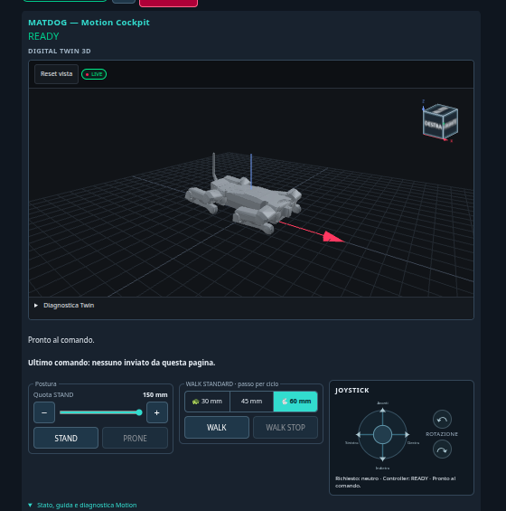
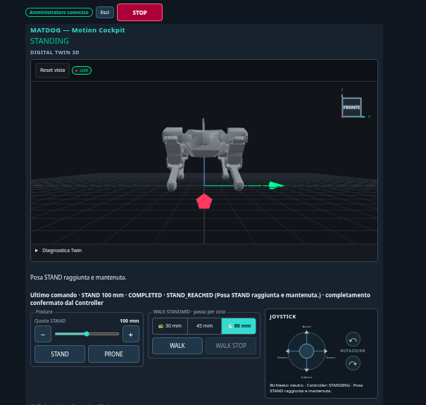

# MATDOG — quadrupede robotico di Matt Robotics

MATDOG è un quadrupede costruito da zero. Il Controller ESP32-S3 è l'unica autorità su Motion, servomotori, cinematica, limiti e STOP; la dashboard invia comandi ad alto livello e mostra telemetria e Digital Twin.

## Stato corrente — 10/11/2026

| | |
|---|---|
| **Firmware installato** | `1.0.2-dev.6` ACC 220: **build di sviluppo**, non una release |
| **Commit sorgente** | [`450d2c793dcb76d08ea341eb5c4b1e50215cee40`](https://github.com/MattRobotics/robot-dog/commit/450d2c793dcb76d08ea341eb5c4b1e50215cee40), in `main` dalla [PR #67](https://github.com/MattRobotics/robot-dog/pull/67) |
| **Build e APP verificata** | Build `450d2c793dcb`, CLEAN, `ROBOT_POWERED`. APP 1 751 040 B, SHA256 `82122e06b6708a9d687f4525f612182c227134f3abcac27f32ed7e266be04256`. Flash APP-only con verify il 10/11/2026 |
| **Validazione hardware del 10/11** | **Fixture Q1–Q8 qualificata:** SLOW, STANDARD e FAST, cambi di profilo in camminata, STOP nelle transizioni, joystick in avanti, SAFE_OFF via PRONE. **14 STOP d'emergenza verificati su 14** (8 sulla fixture, 6 a terra), 0 fault Motion, registro ACC 85 = 220 su tutti i 12 ST3215. **A terra la verifica è positiva ma fuori dal protocollo G0–G5:** non è una qualifica a terra |
| **Release stabile** | [`v1.0.1`](https://github.com/MattRobotics/robot-dog/releases/tag/v1.0.1) (07/11/2026, `1.0.1-dev.17`): baseline storica immutabile, non più installata dall'08/11/2026 |
| **Rollback** | `1fbee7b` (APP `39840bd4…`), con script e asset conservati sull'ASUS |
| **Gemello MuJoCo V1** | [`06_Software/Matdog_MuJoCo`](06_Software/Matdog_MuJoCo/README.md), integrato con la [PR #68](https://github.com/MattRobotics/robot-dog/pull/68); baseline congelata dal tag [`matdog-mujoco-v1-20261110`](https://github.com/MattRobotics/robot-dog/tree/matdog-mujoco-v1-20261110). È una simulazione offline: **non è una qualifica hardware** |

[Validazione hardware 10/11](09_Logs/Validation_Reports/Dev6_ACC220_HW_2026-11-10/REPORT.md) · [Evidenze e SHA256](09_Logs/Validation_Reports/Dev6_ACC220_HW_2026-11-10/EVIDENCE_MANIFEST.md) · [Changelog del Controller](05_Firmware/MATDOG_Controller/CHANGELOG.md) · [Rapporti Motion dev.4 → dev.6](09_Logs/Validation_Reports/README.md) · [Gemello: rapporto M5](06_Software/Matdog_MuJoCo/REPORT_M5.md) e [viewer](06_Software/Matdog_MuJoCo/README.md#visual-supervision) · [Problemi aperti](09_Logs/OPEN_ITEMS.md)

L'APP verificata si identifica da manifest e SHA256, conservati sull'ASUS ([manifest delle evidenze](09_Logs/Validation_Reports/Dev6_ACC220_HW_2026-11-10/EVIDENCE_MANIFEST.md)). **Una ricompilazione di `main` non è quell'APP.**

## Release stabile storica `v1.0.1` (07/11/2026)

Prima release stabile del robot, installata fino all'08/11/2026 e oggi baseline storica. **Non descrive il firmware attualmente installato.**

| Firmware della release | Build | APP SHA256 |
|---|---|---|
| `1.0.1-dev.17` | `17db0efe2324` | `14e055a0bfa2adcab8f87df29ece0a0cf01a6e9e13b99aee1c94bda59ba84a83` |

**Release [`v1.0.1`](https://github.com/MattRobotics/robot-dog/releases/tag/v1.0.1) — VERIFIED HARDWARE, CURRENT ROBOT, QUALIFIED FUNCTIONAL SCOPE (07/11/2026).** Al 07/11/2026 sul robot era installata e collaudata l'APP `MATDOG Controller 1.0.1-dev.17`, build `17db0efe2324`, compilata dal commit `17db0efe23242ae8932b5549546a9758d9aa4645`: 1.707.808 B, SHA256 `14e055a0bfa2adcab8f87df29ece0a0cf01a6e9e13b99aee1c94bda59ba84a83`, `ROBOT_POWERED`, `app0` @ `0x010000`. Il tag `v1.0.1` promuove **questi stessi byte** senza ricompilazione: la stringa interna del firmware resta `1.0.1-dev.17`. Da questa release `main` è la sorgente canonica. Il tag pubblico `v1.0.1` resta immutabile; eventuali correzioni documentali successive su `main` non alterano il firmware rilasciato.

**Provato sul robot:** flash APP-only con verifica del digest, boot READY/RUN, NVS gen-1 `VALID_ACKNOWLEDGED`, census 13/13; dashboard Motion Cockpit, STAND100/125 e HOLD, WALK STANDARD 45/60 mm, WALK STOP, STOP durante il moto e WALK diretto dopo STOP, joystick proporzionale e rilascio, PRONE con SAFE_OFF 13/13; Digital Twin recuperabile dopo refresh in HOLD con coppia ON, ViewCube e Reset vista. Nessun fault nei campioni conservati.

**Limiti noti accettati:** overrun e release perse in locomozione (finestra joystick: +64 perse, +491 overrun, lavoro max 47,2 ms; minimo stack del loop 2.060 B), gait lento, sway laterale del joystick, rari ritardi HTTP con coppia ON di causa non attribuita, STOP durante il caricamento a freddo del Twin su telefono non misurato end-to-end. Non è una certificazione di sicurezza né una garanzia real-time a 20 ms; vale per questo robot.

[Validazione hardware dev.17](09_Logs/Validation_Reports/Dev17_HW_2026-11-07/REPORT.md) · [Manifest firmware/release](09_Logs/Validation_Reports/Dev17_HW_2026-11-07/RELEASE_MANIFEST.md) · [Evidenze e SHA256](09_Logs/Validation_Reports/Dev17_HW_2026-11-07/EVIDENCE_MANIFEST.md) · [Candidata dev.17: cause e regressioni offline](09_Logs/Validation_Reports/Dev17_Candidate_2026-11-07/REPORT.md) · [Installazione APP-only e rollback](09_Logs/Validation_Reports/Dev17_HW_2026-11-07/RELEASE_MANIFEST.md#3-installazione-app-only-e-rollback-solo-questo-robot) · [Problemi aperti](09_Logs/OPEN_ITEMS.md)

**Rollback di allora:** dev.16 `e0ddbb1791d0` (APP `73952eec…`), VERIFIED HARDWARE il 07/11, conservata sull'ASUS con script qualificato. Il solo sorgente `main` non sostituisce l'APP binaria pubblicata e verificata.

## MATDOG Motion Cockpit (dev.17, 07/11/2026)

Dashboard reale del Controller dev.17 durante il collaudo del 07/11/2026 (screenshot originali dell'operatore, byte-identici a quelli nell'[archivio hardware](09_Logs/Validation_Reports/Dev17_HW_2026-11-07/raw/MATDOG_DEV17_HARDWARE_VALIDATION_2026-11-07.zip); [dossier](09_Logs/Validation_Reports/Dev17_HW_2026-11-07/REPORT.md)).

| READY: Digital Twin, ViewCube e comandi | STAND100 raggiunto: vista frontale del Twin |
|---|---|
|  |  |

## Contesto storico (non rappresenta il firmware corrente)

Dopo `v1.0.1` la linea Motion è proseguita nella [PR #67](https://github.com/MattRobotics/robot-dog/pull/67):
- `1.0.2-dev.4`, installata l'08/11 ([validazione](09_Logs/Validation_Reports/Dev4_HW_2026-11-08/REPORT.md));
- le build `1.0.2-dev.6` del 09–10/11: profili SLOW, STANDARD e FAST, registro ACC 85;
- `450d2c7`, installata il 10/11.

Ogni build, con APP e stato, è nel [changelog del Controller](05_Firmware/MATDOG_Controller/CHANGELOG.md).

Il [report dev.16](09_Logs/Validation_Reports/Dev16_HW_2026-11-07/REPORT.md) documenta il firmware precedente, ora conservato per rollback. Il [report dev.15](09_Logs/Validation_Reports/Dev15_HW_2026-11-06/REPORT.md) documenta i problemi di quella build: la discesa PRONE interrotta a quota intermedia (corretta dalla dev.16) e i 503 su `/status` (corretti dalla dev.17), non presenti nelle prove hardware successive. I limiti ancora aperti sono quelli elencati sopra. I relativi log e le RCA rimangono nei dossier originali; le vecchie etichette DRAFT/non-flashata hanno valore soltanto alla loro data.

## Hardware e architettura

| Parte | Configurazione effettiva |
|---|---|
| Controller | ESP32-S3, unica autorità su Motion, bus servo e sicurezza runtime |
| Attuatori | 12 ST3215 delle zampe più collo ID51: 13 installati, 17 posizioni canoniche allocate |
| Sensori | IMU BNO085, BMS DALY, feedback di posizione, carico, tensione e temperatura dei servo |
| Interfaccia | Dashboard web dell'ESP32; comandi semantici STAND, PRONE, WALK SLOW/STANDARD/FAST, joystick e STOP; Twin in sola lettura |
| Motion | Stack SIMPLE: gait, cinematica inversa, compensazione IMU, frame coordinati e feedback asincrono |
| Geometria | URDF operativo REV01-FIX; mapping e calibrazione persistente gen-1 preservati |
| Alto livello | Jetson Orin Nano Super previsto per integrazioni successive; nessuna autorità diretta browser → servo |

## Provenienza del firmware e tag storici

| Linea | Significato |
|---|---|
| **1.0.2-dev.6 ACC 220** | **Installata dal 10/11/2026**: sorgente `450d2c7`, build `450d2c793dcb`, APP `82122e06…`, in `main` dalla [PR #67](https://github.com/MattRobotics/robot-dog/pull/67). Fixture Q1–Q8 qualificata, terra fuori protocollo ([validazione](09_Logs/Validation_Reports/Dev6_ACC220_HW_2026-11-10/REPORT.md)). Build di sviluppo, non una release. |
| **main** | **Sorgente canonica.** Dal 10/11/2026 contiene la build installata `450d2c7` (PR #67) e il gemello MuJoCo V1 (PR #68); in precedenza, dal merge della [PR #64](https://github.com/MattRobotics/robot-dog/pull/64) (07/11/2026), dev.15, dev.16 e dev.17. Il tag [`v1.0.1`](https://github.com/MattRobotics/robot-dog/releases/tag/v1.0.1) punta al commit di merge; l'APP rilasciata è compilata da `17db0ef`, il cui codice eseguibile è identico a quello su `main`. Non flashare una ricompilazione di `main` al posto dell'asset verificato. |
| **dev.14** | Firmware installato e validato parzialmente **il 05/11**, ora storico; sorgente sul [checkpoint](https://github.com/MattRobotics/robot-dog/tree/checkpoint/matdog-dev14-hw-20261105). |
| **dev.15** | Validata parzialmente il 06/11/2026; PRONE allora intermittente. Sorgente `7997ad4` incluso nella storia oggi mergiata su `main` con PR #64. Non è il firmware attualmente installato. [Dossier storico](09_Logs/Validation_Reports/Dev15_HW_2026-11-06/REPORT.md). |
| **dev.17** | **Stable storica, non più installata dall'08/11.** Allora installata, VERIFIED HARDWARE nel perimetro qualificato e rilasciata come prima Stable [`v1.0.1`](https://github.com/MattRobotics/robot-dog/releases/tag/v1.0.1)** (07/11/2026): commit `17db0ef`, build `17db0efe2324`, APP `14e055a0bfa2adcab8f87df29ece0a0cf01a6e9e13b99aee1c94bda59ba84a83`. HTTP di stato senza slack, letture oltre il recupero TCP, joystick stabile e in ordine, Twin dopo refresh con coppia ON, WALK diretto dopo STOP, Motion Cockpit e ViewCube. [Dossier HW](09_Logs/Validation_Reports/Dev17_HW_2026-11-07/REPORT.md) · [candidata](09_Logs/Validation_Reports/Dev17_Candidate_2026-11-07/REPORT.md). La build `7503bfc` è superata e non rilasciata. |
| **dev.16** | **Rollback.** Installata e validata hardware il 07/11 (prima della dev.17) nel perimetro STAND/PRONE/WALK/STOP provato (candidata del 07/11 mattina): commit `e0ddbb1`, APP `73952eec1ddb29976941b7afd16149b15f790a2e8c46cb2067d1f72a8424138d`, ora nella storia di `main` dopo il merge della PR #64. Corregge la consegna PRONE a quota intermedia, aggiunge diagnostica timing (T0) e riuso IMU a release alterne (T1). [Dossier HW](09_Logs/Validation_Reports/Dev16_HW_2026-11-07/REPORT.md). |
| **dev.7** | [Pre-release storica pubblicata](https://github.com/MattRobotics/robot-dog/releases/tag/matdog-controller-v1.0.1-dev.7), con [report del31/10](09_Logs/Validation_Reports/Motion_dev7_HW_2026-10-31/REPORT.md). Non è più il firmware installato e non viene promossa a stable. |

Identità storica dev.14 (05/11): commit `4ff2aadf4ed907d39f2b3ad4f9e6af54db5decee`, build `4ff2aadf4ed9`, profilo ROBOT_POWERED, OTA ingest0. APP SHA256: `71028f95a8aee4b4ff7237f9420eec6aeeb0efa0aee5c00c00ca5a7bb947bd22`. Il tag conserva il sorgente; non è una nuova GitHub Release e non garantisce una ricompilazione bit-identica.

## Priorità aperte

- **Motion dopo il 10/11:**
  - qualifica a terra G0–G5 (batteria ≥ 11,0 V, anticaduta confermata);
  - STOP a terra a fine swing anteriore;
  - joystick laterale, in rotazione e all'indietro in STANDARD e FAST (handoff della sessione firmware);
  - cambio di profilo con la leva tenuta, da provare sull'HW;
  - avviso batteria a coppia ON;
  - diagnostica: release perse nelle riprese, HTTP 503 in sterzata, temperature spurie.

  Dettagli in [OPEN_ITEMS](09_Logs/OPEN_ITEMS.md).
- **Gemello MuJoCo:** discrepanza residua dei carichi a terra (rapporto M5). Per calibrarla servono misure nuove, come le forze ai piedi.

- **[#52 — Motion](https://github.com/MattRobotics/robot-dog/issues/52):** overrun e release perse in WALK/joystick, margine di stack del loop, velocità del gait (obiettivo fino a 5×, **non validato**), sway del joystick, durata di WALK_SETTLE, risposta ROLL.
- **[#62 — Dashboard, Twin e LED](https://github.com/MattRobotics/robot-dog/issues/62):** HTTP/Twin/ViewCube migliorati e provati in dev.17; restano la causa delle perdite TCP con coppia ON, la misura dello STOP su telefono durante il caricamento a freddo del Twin, l'overlay trasparente dei comandi nel Twin, il pavimento del Twin in PRONE e la qualificazione dei LED.
- **[#48 — RESTORE e manutenzione](https://github.com/MattRobotics/robot-dog/issues/48):** RESTORE automatico gen-1 verificato a ogni boot; RESTORE manuale da dashboard, rifiuti per giunto, modalità manutenzione e multigenerazione ancora da qualificare.

## Orientarsi nel repository

- [Architettura](01_Docs/02_Architecture/ARCHITECTURE.md), [firmware](05_Firmware/README.md), [software e Twin](06_Software/README.md), [gemello MuJoCo](06_Software/Matdog_MuJoCo/README.md), [CAD](03_CAD/README.md), [elettronica e alimentazione](04_Electronics/README.md).
- [Report e log](09_Logs/README.md), [cronologia](09_Logs/HISTORY_INDEX.md), [problemi aperti](09_Logs/OPEN_ITEMS.md).
- [Storia firmware fino al26/10](09_Logs/Firmware_History/README.md) e [snapshot documentali precedenti](09_Logs/Historical/Dev14_Documentation_Closeout_2026-11-05/README.md). Documenti originali conservati; le loro condizioni sono riferite alle rispettive date.

## Operazioni e sicurezza

Non usare il solo nome di un branch per scegliere un firmware da installare: servono artefatto, manifest, SHA e procedura APP-only supervisionata. La pubblicazione di sorgenti o documentazione non autorizza flash o movimenti. Nessun movimento al boot; l'ammissione Motion è governata a runtime dall'ESP32.

Con caricatore collegato il bus può restare alimentato anche con KEY OFF. Preservare STOP, limiti, NVS e mapping; nessuna scrittura EEPROM/offset servo fuori da procedure autorizzate. [Avvertenze flash e relativo contesto storico](05_Firmware/MATDOG_Controller/FLASH_LAYOUT_SAFETY_NOTICE.md) · [stati di alimentazione](04_Electronics/MATDOG_POWER_STATES_AND_CHARGING.md).

Per agenti AI: [AGENTS.md](AGENTS.md).
